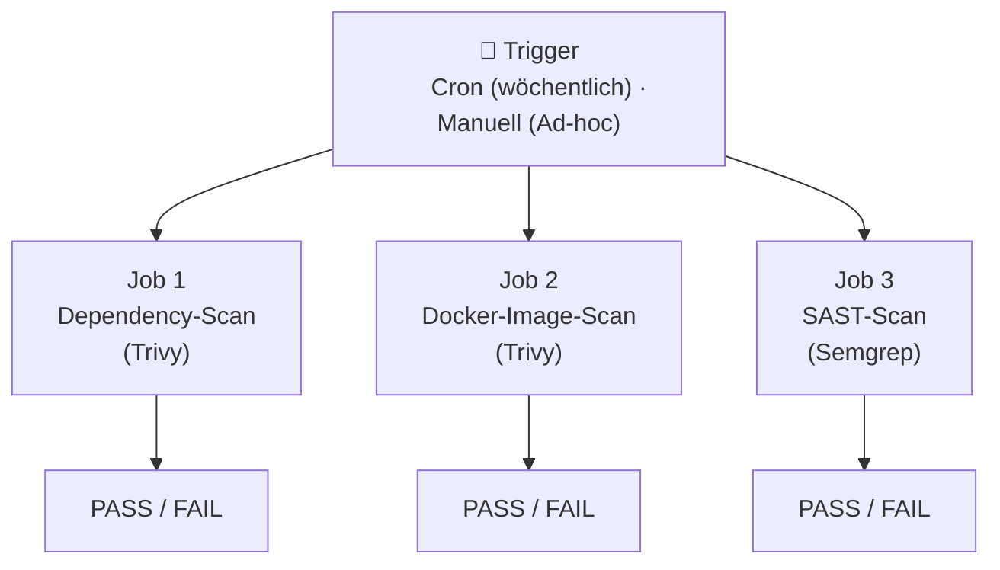

# Konzept: Wöchentliche Vulnerability-Scan Pipeline

> **Projekt:** ScaleTrack (weight-tracking)  
> **Erstellt:** 13. Februar 2026  
> **Status:** Entwurf  
> **Basiert auf:** [REQUIREMENTS-VULNERABILITY-PIPELINE.md](REQUIREMENTS-VULNERABILITY-PIPELINE.md)  
> **Zielgruppe:** Junior Entwickler

---

## Inhaltsverzeichnis

1. [Einleitung & Ziel](#1-einleitung--ziel)
2. [Grundlagen für Einsteiger](#2-grundlagen-für-einsteiger)
3. [Architektur-Übersicht](#3-architektur-übersicht)
4. [Job 1: Dependency-Scan](#4-job-1-dependency-scan)
5. [Job 2: Docker-Image-Scan](#5-job-2-docker-image-scan)
6. [Job 3: SAST-Scan](#6-job-3-sast-scan)
7. [Konfiguration & Severity-Schwellen](#7-konfiguration--severity-schwellen)
8. [Zusammenfassung pro Job](#8-zusammenfassung-pro-job)
9. [Testen & Verifizieren](#9-testen--verifizieren)
10. [Troubleshooting](#10-troubleshooting)
11. [Ausblick](#11-ausblick)

---

## 1. Einleitung & Ziel

### Warum brauchen wir diese Pipeline?

Unser Projekt ScaleTrack nutzt zahlreiche Drittanbieter-Pakete (npm-Abhängigkeiten), ein Docker-Image für den Betrieb und natürlich unseren eigenen Quellcode. In jeder dieser drei Schichten können sich **Sicherheitslücken** (sogenannte Vulnerabilities) verbergen — manchmal schon ab dem Tag, an dem wir eine Abhängigkeit installieren, manchmal erst Wochen später, wenn eine neue Schwachstelle öffentlich bekannt wird.

Ohne automatisierte Prüfung bemerken wir solche Sicherheitslücken möglicherweise erst, wenn es zu spät ist. Deshalb soll eine Pipeline eingerichtet werden, die **einmal pro Woche automatisch** alle drei Bereiche scannt und uns im Fehlerfall sofort informiert.

### Was genau soll passieren?

Es wird eine einzige Workflow-Datei für Gitea Actions erstellt, die drei voneinander unabhängige Prüfungen (Jobs) parallel ausführt:

- **Dependency-Scan** — Prüft unsere npm-Pakete auf bekannte Schwachstellen.
- **Docker-Image-Scan** — Prüft unser fertiges Container-Image auf Schwachstellen im Betriebssystem und in Systempaketen.
- **SAST-Scan** — Prüft unseren eigenen Quellcode auf sicherheitsrelevante Programmierfehler.

Die Pipeline soll jeden **Montag um 06:00 Uhr UTC** automatisch laufen, kann aber auch jederzeit manuell ausgelöst werden.

---

## 2. Grundlagen für Einsteiger

Dieses Kapitel erklärt die wichtigsten Begriffe, die im weiteren Dokument verwendet werden. Wenn du mit einem Begriff bereits vertraut bist, überspringe ihn einfach.

### Vulnerability (Sicherheitslücke)

Eine Vulnerability ist eine Schwachstelle in einer Software, die von Angreifern ausgenutzt werden kann. Das kann ein Fehler in einem npm-Paket sein, eine unsichere Standardkonfiguration im Betriebssystem oder ein Programmierfehler im eigenen Code. Sobald eine Schwachstelle öffentlich bekannt wird, erhält sie üblicherweise eine **CVE-Nummer** (Common Vulnerabilities and Exposures) — eine weltweit eindeutige Kennung wie z.B. „CVE-2024-12345".

### Severity-Stufen

Jede bekannte Schwachstelle wird nach ihrem Schweregrad klassifiziert. Die gängigen Stufen sind:

| Stufe | Bedeutung |
|-------|-----------|
| **CRITICAL** | Schwerwiegend. Kann sofort ausgenutzt werden, z.B. für Remotezugriff ohne Authentifizierung. |
| **HIGH** | Hohes Risiko. Erfordert möglicherweise eine bestimmte Konfiguration, ist aber dennoch ernst. |
| **MEDIUM** | Mittleres Risiko. Ausnutzung erfordert spezielle Bedingungen. |
| **LOW** | Geringes Risiko. Schwer auszunutzen oder geringe Auswirkung. |
| **UNKNOWN** | Schweregrad wurde (noch) nicht bewertet. |

Unsere Pipeline soll standardmäßig bei **CRITICAL** und **HIGH** fehlschlagen. Dieser Schwellenwert ist konfigurierbar (siehe Kapitel 7).

### Dependency-Scan

Ein Dependency-Scan untersucht die Abhängigkeiten (Dependencies) eines Projekts — in unserem Fall die npm-Pakete, die in der `package-lock.json` aufgelistet sind. Der Scanner vergleicht jedes Paket mit einer Datenbank bekannter Schwachstellen und meldet Treffer.

### SAST (Static Application Security Testing)

SAST ist eine Analysemethode, die den **eigenen Quellcode** durchsucht, ohne ihn auszuführen. Dabei werden bekannte unsichere Muster erkannt, z.B. SQL-Injection-Anfälligkeiten, hartcodierte Passwörter oder unsichere Kryptografie. SAST ergänzt den Dependency-Scan: Während der Dependency-Scan Probleme in fremdem Code findet, findet SAST Probleme in **unserem** Code.

### Trivy

Trivy ist ein quelloffenes Sicherheits-Scantool der Firma Aqua Security. Es kann verschiedene Arten von Scans durchführen. Für unser Projekt nutzen wir zwei Scan-Modi:

- **Filesystem-Scan (fs):** Trivy durchsucht das Dateisystem nach Dependency-Dateien (wie `package-lock.json`) und gleicht die gefundenen Pakete mit seiner Schwachstellen-Datenbank ab.
- **Image-Scan (image):** Trivy analysiert ein Docker-Image Schicht für Schicht und prüft sowohl das Betriebssystem als auch installierte Pakete auf bekannte Schwachstellen.

### Semgrep

Semgrep ist ein quelloffenes SAST-Tool, das Quellcode anhand von Regeln (Patterns) durchsucht. Es wird mit einem umfangreichen Standard-Regelset ausgeliefert (`p/default`), das viele gängige Sicherheitsprobleme in TypeScript und JavaScript erkennt. Im Gegensatz zu einem Linter wie ESLint konzentriert sich Semgrep auf **sicherheitsrelevante** Muster.

### Gitea Actions

Gitea Actions ist das CI/CD-System unserer Gitea-Instanz. Es funktioniert weitgehend wie GitHub Actions: Workflow-Dateien im YAML-Format definieren, welche Schritte bei bestimmten Ereignissen (z.B. Push, Zeitplan) ausgeführt werden. Unsere Workflow-Datei wird im Ordner `.gitea/workflows/` abgelegt. Der Gitea Runner — der Rechner, der die Workflows ausführt — ist bereits eingerichtet und hat Zugriff auf die Docker-Kommandozeile.

### Cron-Trigger

Ein Cron-Trigger ist ein zeitgesteuerter Auslöser. Die Cron-Syntax besteht aus fünf Feldern, die Minute, Stunde, Tag im Monat, Monat und Wochentag angeben. So lässt sich z.B. „jeden Montag um 06:00 UTC" ausdrücken. Gitea Actions unterstützt diese Syntax im `schedule`-Block der Workflow-Datei.

### Workflow Dispatch

Neben dem zeitgesteuerten Trigger soll der Workflow auch manuell über die Gitea-Weboberfläche auslösbar sein. Dies nennt man `workflow_dispatch`. Damit kann man bei Bedarf jederzeit einen Ad-hoc-Scan starten, ohne auf den wöchentlichen Zeitplan warten zu müssen.

---

## 3. Architektur-Übersicht

### Gesamtablauf

Die Pipeline wird durch einen von zwei Triggern ausgelöst und führt dann drei voneinander unabhängige Jobs parallel aus:



### Wichtige Eigenschaften

- **Parallelität:** Alle drei Jobs starten gleichzeitig. Es gibt keine Abhängigkeiten zwischen ihnen. Dadurch ist die Gesamtlaufzeit so kurz wie möglich.
- **Unabhängiges Fehlschlagen:** Wenn ein Job Schwachstellen findet und fehlschlägt, hat das keinen Einfluss auf die anderen beiden Jobs. Jeder Job wird als eigenständig bewertet.
- **Branch-Beschränkung:** Die Pipeline läuft ausschließlich auf dem Branch `main`. Feature-Branches werden nicht gescannt.
- **Keine Artefakte:** Die Ergebnisse werden direkt im Pipeline-Log von Gitea ausgegeben. Es werden keine Dateien gespeichert oder an externe Systeme gesendet.

### Workflow-Datei

Die gesamte Pipeline wird in **einer einzigen** Workflow-Datei definiert. Diese Datei muss unter folgendem Pfad im Repository angelegt werden:

```
.gitea/workflows/vulnerability-scan.yml
```

Der Ordner `.gitea/workflows/` existiert noch nicht und muss neu erstellt werden.

---

## 4. Job 1: Dependency-Scan

### Was wird gescannt?

Dieser Job prüft unsere **npm-Abhängigkeiten** — also alle Drittanbieter-Pakete, die wir in der `package.json` deklariert haben und die in der `package-lock.json` mit ihren exakten Versionen festgehalten sind. Das betrifft sowohl direkte Abhängigkeiten (z.B. `next`, `react`) als auch transitive Abhängigkeiten (Pakete, die unsere Pakete ihrerseits benötigen).

### Warum ist das wichtig?

Unser Projekt verwendet über 30 direkte Abhängigkeiten, die ihrerseits hunderte weitere Pakete mitbringen. Wenn in einem dieser Pakete eine Schwachstelle bekannt wird, sind wir potenziell betroffen — auch wenn wir selbst keinen unsicheren Code geschrieben haben.

### Wie funktioniert der Scan?

Der Job besteht aus folgenden Schritten:

1. **Code auschecken:** Der Quellcode des Repositories wird aus dem `main`-Branch geholt.
2. **Dependencies installieren:** Der Befehl `npm ci` wird ausgeführt. Dieser installiert die Abhängigkeiten exakt so, wie sie in der `package-lock.json` definiert sind. Dieser Schritt ist notwendig, damit Trivy eine vollständige und aktuelle Abhängigkeitsliste vorfindet.
3. **Trivy Filesystem-Scan ausführen:** Trivy wird im Modus `fs` (Filesystem) auf das Projektverzeichnis losgelassen. Es erkennt automatisch die `package-lock.json` und gleicht alle darin enthaltenen Pakete mit seiner Schwachstellen-Datenbank ab.
4. **Ergebnis auswerten:** Trivy gibt die Ergebnisse als Tabelle in der Konsolenausgabe aus. Wenn Schwachstellen gefunden werden, deren Schweregrad dem konfigurierten Schwellenwert entspricht (standardmäßig CRITICAL oder HIGH), beendet sich Trivy mit einem Fehler-Exit-Code und der Job schlägt fehl.
5. **Zusammenfassung ausgeben:** Am Ende des Jobs wird eine kurze Zusammenfassung erstellt (siehe Kapitel 8).

### Worauf ist bei der Implementierung zu achten?

- Trivy muss als Tool im Runner verfügbar sein. Es kann entweder über die offizielle Trivy-Action eingebunden oder direkt über ein Installationsskript heruntergeladen und aufgerufen werden. Da Gitea Actions weitgehend GitHub-Actions-kompatibel ist, sollte zuerst die Action-Variante geprüft werden. Falls es Kompatibilitätsprobleme gibt, kann auf die direkte CLI-Installation ausgewichen werden.
- Der Severity-Filter muss aus der zentralen Environment-Variable `TRIVY_SEVERITY` gelesen werden (siehe Kapitel 7).
- Der Exit-Code bei einem Fund muss auf `1` gesetzt sein, damit der Job als fehlgeschlagen markiert wird.
- Das Ausgabeformat soll `table` sein, damit die Ergebnisse im Pipeline-Log gut lesbar sind.

---

## 5. Job 2: Docker-Image-Scan

### Was wird gescannt?

Dieser Job prüft das **fertig gebaute Docker-Image** unserer Anwendung. Dabei wird nicht nur unser Anwendungscode geprüft, sondern vor allem das darunterliegende Betriebssystem (Alpine Linux) und die darin installierten Systempakete (wie `openssl`, `libc6-compat` usw.).

### Warum reicht der Dependency-Scan allein nicht aus?

Der Dependency-Scan aus Job 1 prüft nur die npm-Pakete. Unser Docker-Image enthält jedoch eine ganze Betriebssystemschicht mit eigenen Paketen, die nichts mit npm zu tun haben. Eine Schwachstelle in `openssl` innerhalb des Alpine-Base-Images wäre für den Dependency-Scan unsichtbar — der Docker-Image-Scan findet sie aber.

### Wie funktioniert der Scan?

1. **Code auschecken:** Wie bei Job 1 wird der Quellcode geholt.
2. **Docker-Image bauen:** Das Docker-Image wird lokal auf dem Runner gebaut. Dafür wird der vorhandene `Dockerfile` im Projektroot verwendet. Das Image erhält einen temporären Tag-Namen (z.B. `scaletrack:scan`), der nur für den Scan existiert. Das Image wird **nicht** in eine Registry gepusht — es dient ausschließlich dem Scan.
3. **Trivy Image-Scan ausführen:** Trivy wird im Modus `image` auf das gebaute Image angewendet. Es analysiert jede Schicht des Images und gleicht gefundene Betriebssystem- und Anwendungspakete mit seiner Schwachstellen-Datenbank ab.
4. **Ergebnis auswerten:** Wie bei Job 1 wird das Ergebnis als Tabelle ausgegeben. Bei Funden ab dem konfigurierten Schweregrad schlägt der Job fehl.
5. **Zusammenfassung ausgeben:** Am Ende des Jobs wird eine kurze Zusammenfassung erstellt (siehe Kapitel 8).

### Worauf ist bei der Implementierung zu achten?

- Der Runner hat Zugriff auf die Docker-CLI — es sind keine besonderen Berechtigungs-Konfigurationen nötig.
- Der Docker-Build benötigt Zeit (Multi-Stage Build mit Prisma-Generierung und Next.js-Build). Dies ist der voraussichtlich langsamste Job.
- Der Severity-Filter muss aus der zentralen Environment-Variable `TRIVY_SEVERITY` gelesen werden.
- Auch hier muss der Exit-Code bei Fund auf `1` und das Ausgabeformat auf `table` stehen.
- Das gebaute Image muss nach dem Scan nicht aufgeräumt werden, da der Runner nach Jobende ohnehin aufgeräumt wird.

---

## 6. Job 3: SAST-Scan

### Was wird gescannt?

Dieser Job prüft unseren **eigenen Quellcode** im Verzeichnis `src/` auf sicherheitsrelevante Programmierfehler und unsichere Muster. Im Gegensatz zu den ersten beiden Jobs, die nach bekannten Schwachstellen in fremdem Code suchen, sucht der SAST-Scan nach Problemen, die **wir selbst** verursacht haben.

### Welche Art von Problemen findet SAST?

Typische Funde sind zum Beispiel:

- **Hartcodierte Geheimnisse:** Passwörter, API-Keys oder Tokens direkt im Quellcode.
- **Injection-Schwachstellen:** Stellen, an denen Benutzereingaben ungefiltert in Datenbankabfragen oder Kommandozeilen-Aufrufe einfließen.
- **Unsichere Kryptografie:** Verwendung veralteter oder schwacher Hash- und Verschlüsselungsverfahren.
- **Path Traversal:** Dateizugriffe, bei denen der Pfad durch Benutzereingaben manipuliert werden kann.
- **Unsichere Konfigurationen:** z.B. deaktivierte Sicherheitsprüfungen oder zu offene CORS-Einstellungen.

### Wie funktioniert der Scan?

1. **Code auschecken:** Der Quellcode wird aus dem `main`-Branch geholt.
2. **Semgrep ausführen:** Semgrep wird mit dem Standard-Regelset `p/default` auf das Verzeichnis `src/` ausgeführt. Dieses Regelset enthält Hunderte von Regeln, die speziell für TypeScript und JavaScript relevante Sicherheitsmuster erkennen.
3. **Ergebnis auswerten:** Semgrep gibt die Ergebnisse als lesbaren Text in der Konsole aus. Es zeigt an, in welcher Datei und Zeile ein Problem gefunden wurde, welche Regel ausgeschlagen hat und warum das Muster als unsicher gilt. Bei Funden ab dem konfigurierten Schweregrad schlägt der Job fehl.
4. **Zusammenfassung ausgeben:** Am Ende des Jobs wird eine kurze Zusammenfassung erstellt (siehe Kapitel 8).

### Worauf ist bei der Implementierung zu achten?

- Semgrep kann als offizielle Action, als Docker-Container oder über `pip install semgrep` installiert werden. Die Kompatibilität mit Gitea Actions sollte geprüft werden — im Zweifelsfall ist die direkte CLI-Installation über pip der zuverlässigste Weg.
- Das Scan-Ziel ist ausschließlich das Verzeichnis `src/`. Konfigurationsdateien im Projektroot oder generierte Dateien sollen nicht gescannt werden.
- Der Severity-Filter bei Semgrep unterscheidet sich von Trivy: Semgrep verwendet die Stufen `ERROR`, `WARNING` und `INFO` (statt CRITICAL/HIGH/MEDIUM/LOW). Die Zuordnung zum Pipeline-Verhalten wird über die Environment-Variable `SEMGREP_SEVERITY` gesteuert (siehe Kapitel 7).
- Das Ausgabeformat soll `text` sein.
- Semgrep muss im Fehlermodus betrieben werden, sodass bei Funden ein Fehler-Exit-Code zurückgegeben wird.

---

## 7. Konfiguration & Severity-Schwellen

### Zentrale Konfiguration über Environment-Variablen

Die Severity-Schwellen sollen **nicht** in den einzelnen Jobs hartcodiert werden, sondern zentral am Anfang der Workflow-Datei als Environment-Variablen definiert werden. Dadurch gibt es genau **eine Stelle**, an der ein Entwickler die Schwellenwerte für die gesamte Pipeline anpassen kann.

Es werden zwei Variablen benötigt:

### Variable 1: TRIVY_SEVERITY

Diese Variable steuert, bei welchen Schweregraden die Trivy-Scans (Job 1 und Job 2) fehlschlagen sollen.

- **Gültige Werte:** `CRITICAL`, `HIGH`, `MEDIUM`, `LOW`, `UNKNOWN`
- **Format:** Komma-separiert, ohne Leerzeichen
- **Standardwert:** `CRITICAL,HIGH`
- **Bedeutung:** Die Pipeline schlägt fehl, wenn Trivy mindestens eine Schwachstelle mit einem der angegebenen Schweregrade findet.
- **Beispiel:** Setzt man den Wert auf `CRITICAL`, werden nur kritische Schwachstellen als Pipeline-Fehler gewertet. HIGH-Funde würden dann zwar angezeigt, aber den Job nicht fehlschlagen lassen.

### Variable 2: SEMGREP_SEVERITY

Diese Variable steuert, bei welchen Schweregraden der Semgrep-Scan (Job 3) fehlschlagen soll.

- **Gültige Werte:** `ERROR`, `WARNING`, `INFO`
- **Format:** Semgrep erwartet den Severity-Filter als separates Argument pro Stufe (nicht komma-separiert wie bei Trivy). In der Variable kann dennoch komma-separiert gespeichert werden, solange der Job-Schritt die Werte korrekt an Semgrep übergibt.
- **Standardwert:** `ERROR,WARNING`
- **Bedeutung:** Die Pipeline schlägt fehl, wenn Semgrep mindestens ein Finding mit einem der angegebenen Schweregrade erkennt.

### Inline-Dokumentation

Direkt über den Variablen-Definitionen in der Workflow-Datei sollen erklärende Kommentare stehen, die folgendes dokumentieren:

- Was die Variable steuert
- Welche Werte gültig sind
- Wie man den Schwellenwert anpasst
- Wo man die Scan-Ergebnisse einsehen kann (im Pipeline-Log des jeweiligen Jobs in Gitea)

---

## 8. Zusammenfassung pro Job

Jeder der drei Jobs soll am Ende seiner Ausführung — unabhängig davon, ob Funde vorliegen — eine kurze, standardisierte **Zusammenfassung** in die Konsolenausgabe schreiben. Diese Zusammenfassung dient dazu, das Ergebnis auf einen Blick erfassbar zu machen, ohne dass man durch die gesamte Scan-Ausgabe scrollen muss.

### Inhalt der Zusammenfassung

Jede Zusammenfassung soll folgende Informationen enthalten:

1. **Tool-Name und Version** — z.B. „Trivy v0.58.0" oder „Semgrep v1.60.0". Die Version kann über einen vorherigen Aufruf des Tools mit einem Versions-Flag ermittelt werden.
2. **Anzahl gefundener Schwachstellen** — Falls das Tool die Anzahl nicht direkt ausgibt, kann sie aus der Scan-Ausgabe abgeleitet werden (z.B. durch Zählen der Tabellenzeilen).
3. **Ergebnis** — Entweder `PASS` (keine relevanten Funde) oder `FAIL` (mindestens ein Fund ab dem konfigurierten Schweregrad).

### Umsetzungshinweis

Die Zusammenfassung kann als einfache Echo-Ausgabe im letzten Schritt des jeweiligen Jobs realisiert werden. Es empfiehlt sich, das Scan-Ergebnis (Exit-Code) in einer Variable zu speichern, damit die Zusammenfassung auch bei einem fehlgeschlagenen Scan noch ausgegeben werden kann, bevor der Job als fehlgeschlagen markiert wird.

---

## 9. Testen & Verifizieren

### Manuelles Auslösen

Nach dem Erstellen und Pushen der Workflow-Datei kann der Workflow über die Gitea-Weboberfläche manuell ausgelöst werden. Dazu navigiert man im Repository zu dem Bereich für Actions/Workflows und nutzt die Option zur manuellen Ausführung (Workflow Dispatch). So lässt sich sofort prüfen, ob die Pipeline grundsätzlich funktioniert, ohne auf den Cron-Zeitplan warten zu müssen.

### Absichtlichen Fund provozieren

Um sicherzustellen, dass die Pipeline bei echten Funden auch tatsächlich fehlschlägt, sollte bewusst ein Testfall eingebaut werden:

- **Für den Dependency-Scan:** Eine npm-Abhängigkeit installieren, die bekannte Schwachstellen hat. Dazu kann man in öffentlichen Datenbanken (z.B. auf der Seite von Snyk oder in der GitHub Advisory Database) nach einem Paket suchen, das eine bekannte CRITICAL- oder HIGH-Schwachstelle aufweist. Dieses Paket temporär als Abhängigkeit hinzufügen, den Scan laufen lassen und anschließend die Abhängigkeit wieder entfernen.
- **Für den SAST-Scan:** Einen offensichtlich unsicheren Code-Schnipsel in eine Testdatei unter `src/` schreiben, z.B. eine Funktion, die eine Benutzereingabe direkt und ungefiltert in einen Befehl einbaut. Nach erfolgreichem Test die Datei wieder löschen.
- **Für den Docker-Scan:** Dieser findet in der Regel ohnehin Findings im Base-Image, da Alpine-Pakete regelmäßig Schwachstellen aufweisen. Falls nicht, kann man die Severity-Schwelle temporär auf `MEDIUM,LOW` erweitern.

**Wichtig:** Alle absichtlich eingebauten Test-Funde müssen nach erfolgreichem Test **umgehend wieder entfernt** werden.

### Ergebnisse im Gitea-Log lesen

Die Scan-Ergebnisse sind in den Logs der einzelnen Jobs einsehbar. In der Gitea-Weboberfläche navigiert man zum ausgeführten Workflow-Run und klickt auf den jeweiligen Job. Die Trivy-Tabellen und die Semgrep-Textausgabe werden dort vollständig dargestellt. Am Ende jedes Jobs steht die Zusammenfassung (PASS oder FAIL).

---

## 10. Troubleshooting

### Trivy-Datenbank kann nicht heruntergeladen werden

Trivy lädt bei jedem Scan seine Schwachstellen-Datenbank herunter. Wenn der Runner keinen Internetzugang hat oder die Datenbank-Server nicht erreichbar sind, schlägt der Scan fehl, noch bevor er beginnt. In diesem Fall sollte geprüft werden, ob der Runner Zugang zum Internet hat. Alternativ kann Trivy so konfiguriert werden, dass es eine gecachte Datenbank verwendet.

### Docker-Build schlägt fehl

Der Docker-Build in Job 2 kann aus verschiedenen Gründen fehlschlagen — z.B. wenn `npm ci` innerhalb des Builds nicht funktioniert (fehlende Umgebungsvariablen, veraltete `package-lock.json`) oder wenn native Module nicht kompiliert werden können. In diesem Fall ist das Problem nicht die Scan-Pipeline selbst, sondern der Dockerfile. Die gleichen Build-Schritte, die lokal oder in einer anderen Pipeline funktionieren, sollten auch hier funktionieren. Fehlermeldungen im Build-Log geben Aufschluss.

### Semgrep ist zu langsam oder bricht ab

Semgrep kann bei sehr großen Codebases oder bestimmten Regelsets langsam werden. Da wir nur das Verzeichnis `src/` scannen und das Standard-Regelset verwenden, sollte dies kein Problem sein. Sollte es dennoch zu Timeouts kommen, kann das Scan-Ziel weiter eingegrenzt werden, oder es können einzelne, langsame Regeln deaktiviert werden.

### Job schlägt fehl, obwohl keine Findings angezeigt werden

Dies kann passieren, wenn die Installation des Scan-Tools selbst fehlschlägt (z.B. fehlende Abhängigkeiten auf dem Runner). In diesem Fall sollte man die Logs vor dem eigentlichen Scan-Schritt prüfen — oft liegt der Fehler in einem vorherigen Installationsschritt.

### Pipeline läuft nicht zum geplanten Zeitpunkt

Gitea Actions Cron-Jobs werden nur ausgelöst, wenn die Workflow-Datei im Default-Branch (in unserem Fall `main`) liegt. Wenn die Datei nur auf einem Feature-Branch existiert, wird der Cron-Trigger nicht ausgelöst. Außerdem kann es bei Gitea je nach Konfiguration eine leichte Verzögerung geben — die Pipeline läuft möglicherweise nicht exakt um 06:00 UTC, sondern wenige Minuten später.

---

## 11. Ausblick

Die folgenden Erweiterungen sind bereits angedacht, aber **nicht Teil dieser Iteration**. Sie werden hier erwähnt, damit der Gesamtkontext verständlich ist.

### Automatische Issue-Erstellung (geplant für v2)

In einer späteren Version soll die Pipeline bei gefundenen Schwachstellen automatisch ein Gitea-Issue erstellen. Dieses Issue würde einen standardisierten Titel, ein Security-Label und eine Zusammenfassung der Findings enthalten. So wird sichergestellt, dass Findings nicht nur im Pipeline-Log versinken, sondern aktiv nachverfolgt werden.

### SARIF-Export (geplant für v2)

Sowohl Trivy als auch Semgrep können ihre Ergebnisse im SARIF-Format (Static Analysis Results Interchange Format) exportieren. Dieses Format ermöglicht die Integration mit Code-Scanning-Dashboards und anderen Sicherheitstools. Für den Moment ist die Tabellenausgabe im Pipeline-Log ausreichend.

### Scan auf Feature-Branches (geplant für v3)

Aktuell läuft der Scan nur auf `main`. In einer zukünftigen Iteration könnte der Scan auch als Teil der Pull-Request-Pipeline ausgeführt werden, sodass Schwachstellen bereits erkannt werden, bevor Code in den Hauptbranch gemergt wird.
